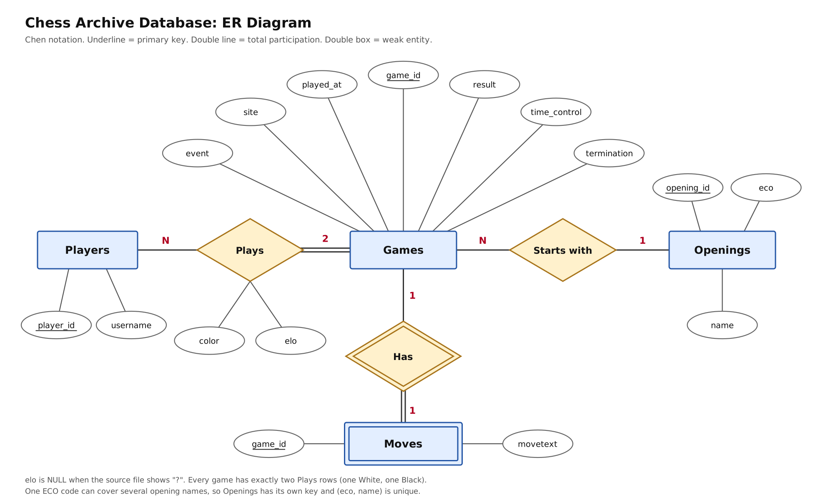

# Design Document

By Sahil Pahuja

Video overview: [PASTE YOUR VIDEO URL HERE]

## Purpose

This database stores rated chess games from the Lichess open database in a relational structure. The raw data is a very large flat text file (PGN) that is slow and awkward to search. By splitting it into related tables with proper keys, constraints, and indexes, the database can answer questions quickly, such as:

- Which openings win most often at a given rating range?
- How does a player's rating change across their games?
- Which time controls are most popular, and how do results differ between them?

The database is designed to stay fast with [100,000+] games, and the design choices and benchmarks are documented below.

## Scope

**In scope**

- **Games:** one row per rated standard game, with its Lichess URL, date and time, result, how it ended, event type, and time control.
- **Players:** identified by their Lichess username, with each player's rating as it was in each game.
- **Openings:** identified by ECO code and name.
- **Moves:** the move list of each game, kept in a separate table because it is large and only needed for some queries.

**Out of scope**

- Chess variants (only standard chess is included).
- Any personal information beyond a public username.
- Engine analysis, evaluations, and move-quality scoring.
- Validating that games follow the rules of chess. The data is assumed to be valid as exported by Lichess.
- Live updates. The database is loaded in batches from a monthly export.
- Games from months other than [February 2017].
- A user-facing application. The database is used directly through SQL.

## Functional Requirements

This database will support:

- Loading games in bulk from a Lichess PGN export, and creating, reading, updating, and deleting individual games, players, and openings.
- Looking up a player and listing every game they played, including their most recent game.
- Showing a player's rating in any game, and how their rating changed over time.
- Looking up an opening's name from its ECO code and an ECO code from an opening name.
- Describing the type of a game through its event and time control.
- Analysis across many games, such as win rate by opening, most popular time controls, and results by rating range.

In this iteration, the database will not support:

- Searching by individual move or position. Moves are stored as one block of text per game.
- Enforcing chess rules or checking that results match the moves.
- Several users editing data at the same time. SQLite allows one writer at a time.

## Representation

Entities are captured in SQLite tables with the following schema.

### Entities

The database includes the following entities:

#### Players

The `players` table includes:

- `player_id`, which specifies the unique ID for the player as an `INTEGER`. This column has the `PRIMARY KEY` constraint applied.
- `username`, which specifies the player's Lichess username as `TEXT`. A `UNIQUE` constraint ensures that no two rows describe the same player, and `NOT NULL` ensures every player has a name. Lichess does not provide a numeric player ID in the export, so the username is the natural identifier, and `player_id` is a compact key created by this database for use in other tables.

#### Openings

The `openings` table includes:

- `opening_id`, which specifies the unique ID for the opening as an `INTEGER`. This column has the `PRIMARY KEY` constraint applied.
- `eco`, which specifies the ECO classification code (for example `B01`) as `TEXT`. A `CHECK` constraint using `GLOB '[A-E][0-9][0-9]'` ensures it has the valid format of one letter from A to E followed by two digits.
- `name`, which specifies the opening's name as `TEXT`.

Both `eco` and `name` are required and have the `NOT NULL` constraint applied. A `UNIQUE` constraint on the pair (`eco`, `name`) prevents duplicate openings. The ECO code alone cannot be the primary key, because one ECO code covers several opening names. That is why the table has its own `opening_id`.

#### Games

The `games` table includes:

- `game_id`, which specifies the unique ID for the game as an `INTEGER`. This column has the `PRIMARY KEY` constraint applied.
- `site`, which is the game's Lichess URL as `TEXT`. The URL contains Lichess's own game ID, so it identifies the game in the source data. A `UNIQUE` constraint ensures the same game cannot be imported twice, which makes the import script safe to run again.
- `event`, which describes the type of game, such as `Rated Blitz game`, as `TEXT`.
- `played_at`, which is the date and time the game started in UTC. The source file gives the date and time as two separate fields, and this column combines them into one value written in the ISO 8601 text format `YYYY-MM-DD HH:MM:SS`. SQLite has no dedicated date type, and this format sorts correctly as text, per the SQLite documentation at <https://www.sqlite.org/datatype3.html>.
- `result`, which is the outcome as `TEXT`. A `CHECK` constraint limits it to `1-0` (White won), `0-1` (Black won), and `1/2-1/2` (draw).
- `time_control`, which is the clock setting as `TEXT`, such as `300+0` (five minutes with no increment). It is kept as text because the source also uses a dash for games with no clock.
- `termination`, which is how the game ended (for example `Normal` or `Time forfeit`) as `TEXT`.
- `opening_id`, which is the ID of the opening the game followed as an `INTEGER`. This column has the `FOREIGN KEY` constraint applied, referencing the `opening_id` column in the `openings` table. It is allowed to be `NULL`, because some games in the source data have no opening recorded.

All other columns are required and have the `NOT NULL` constraint applied.

#### Game players

The `game_players` table links players to games and records what is true about a player in one particular game. It includes:

- `game_id`, which is the ID of the game as an `INTEGER`. This column has the `FOREIGN KEY` constraint applied, referencing the `game_id` column in the `games` table, with `ON DELETE CASCADE` so that deleting a game also deletes its two player rows.
- `player_id`, which is the ID of the player as an `INTEGER`. This column has the `FOREIGN KEY` constraint applied, referencing the `player_id` column in the `players` table.
- `color`, which is the side the player took, as `TEXT`. A `CHECK` constraint limits it to `White` or `Black`.
- `elo`, which is the player's rating at the time of that game, as an `INTEGER`. It is `NULL` when the source data shows `?`. A `CHECK` constraint allows only `NULL` or a value between 0 and 4000, which are deliberately generous bounds.

The primary key is the pair (`game_id`, `color`). This guarantees that a game has at most one White row and one Black row. A second `UNIQUE` constraint on (`game_id`, `player_id`) stops the same player from being listed on both sides of one game. All columns except `elo` have the `NOT NULL` constraint applied.

#### Moves

The `moves` table includes:

- `game_id`, which is the ID of the game as an `INTEGER`. This column is both the `PRIMARY KEY` and a `FOREIGN KEY` referencing the `game_id` column in the `games` table, with `ON DELETE CASCADE`. This makes `moves` a weak entity, since a move list cannot exist without its game, and it limits each game to one move list.
- `movetext`, which is the complete move list in standard algebraic notation as `TEXT`, with the `NOT NULL` constraint applied.

The move list is kept in its own table because it is by far the largest part of each game. Queries that only need results and ratings never have to read it.

### Relationships

The below entity relationship diagram describes the relationships among the entities in the database.

As detailed by the diagram:

- A player can play in 0 to many games: 0 if they appear nowhere in the loaded data, and many if they played repeatedly. A game is played by exactly two players, one as White and one as Black. This many-to-many relationship, called Plays in the diagram, is implemented by the `game_players` table. Its attributes, `color` and `elo`, are stored there because they describe a player in a particular game, not the player or the game alone.
- A game follows at most one opening, whereas an opening can be followed in 0 to many games: 0 if no loaded game used it, and many if it is popular. This is the Starts with relationship, implemented by the `opening_id` foreign key in `games`.
- A game has at most one move list, and a move list belongs to exactly one game. This is the Has relationship, implemented by `moves.game_id`, which is both the primary key and a foreign key.

## Optimizations

Per the typical queries in `queries.sql`, users of the database most often look up all games by a particular player, find a player's most recent game, and group games by opening or time control. The following were created to support them:

- **`players.username`:** the `UNIQUE` constraint already creates an index, so looking up a player by name is fast without extra work.
- **`games.site`:** the `UNIQUE` constraint also creates an index, which makes checking for duplicates during import fast.
- **`game_players(player_id)`:** the primary key starts with `game_id`, so it cannot speed up searches that start from a player. This index makes "all games by player X" fast and is the basis of the most-recent-game query.
- **`games(played_at)`:** speeds up ordering games by date, which the most-recent-game query and rating-history queries need.
- **`games(opening_id)`:** speeds up joins between games and openings and the win-rate-by-opening analysis.

Every index makes the database file larger and slows down the bulk import, so indexes were only added for queries that are actually run. For the bulk import, the secondary indexes can be created after the data is loaded.

Two views were created to make common queries simpler:

- `game_details`, which joins games with the White and Black players and their ratings so that each game appears on one readable row.
- `opening_stats`, which shows the number of games and the White, Black, and draw counts for each opening.

Benchmark results on [N] games, measured with `EXPLAIN QUERY PLAN` and the SQLite `.timer` command:

| Query | Before index | After index | Index that helped |
|---|---|---|---|
| All games by one player | [X ms] | [Y ms] | `game_players(player_id)` |
| Most recent game of a player | [X ms] | [Y ms] | `game_players(player_id)`, `games(played_at)` |
| Win rate by opening | [X ms] | [Y ms] | `games(opening_id)` |

## Limitations

- **Exactly two players per game is not fully enforced.** The primary key on (`game_id`, `color`) and the `CHECK` on `color` guarantee at most two rows per game, but nothing in the schema stops a game from having fewer than two. The import script is responsible for always inserting both rows, and a trigger could enforce this in a future version.
- **Foreign keys must be turned on.** SQLite does not enforce foreign keys unless `PRAGMA foreign_keys = ON;` is run on each connection.
- **Player identity is the username.** Lichess accounts can be renamed or closed, and the export has no permanent player ID, so a renamed player would appear as a new player.
- **Openings are stored as flat names.** An opening such as a Sicilian Defense variation is one text value, and the database does not separate the opening family from the variation.
- **Moves are one block of text.** The database cannot answer questions such as "which games reached this position" or "how often is this move played".
- **Time control is text.** Values like `300+0` cannot be compared or averaged without first splitting them into base time and increment.
- **Only part of the Lichess data is stored.** Player titles, whether a player is a bot, rating changes after the game, and clock data are not kept.
- **SQLite limits scale and concurrency.** It is a good fit for a single-user analytical database of this size, but it allows only one writer at a time and would need to be replaced by a server database such as PostgreSQL for many simultaneous users or much larger data.