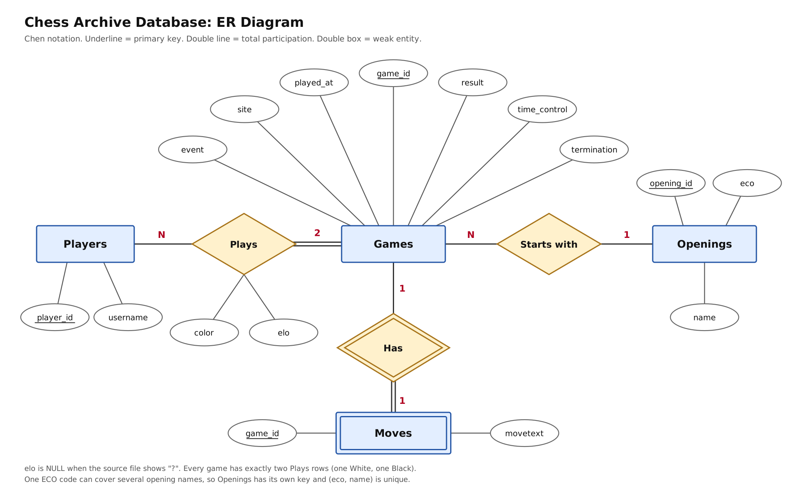

# Chess Archive Database

A normalized SQLite database of rated chess games from the [Lichess open database](https://database.lichess.org), with a Python import pipeline, indexes, views, and query benchmarks.

Built as the final project for **CS50's Introduction to Databases with SQL**, then extended with a bulk import script and performance measurements.

## What it does

The Lichess export is one huge flat text file (PGN) that is slow and awkward to search. This project splits it into related tables with keys and constraints, so questions like these become fast SQL queries:

- Which openings win most often at a given rating range?
- How does a player's rating change across their games?
- What was a player's most recent game?
- Which time controls are most popular, and how do results differ between them?

## Tech

- **SQLite** for the database
- **Python 3** with the [`python-chess`](https://python-chess.readthedocs.io/) library for reading PGN headers
- **SQL** for the schema, views, and queries

## Project structure

```
.
├── schema.sql          # tables, indexes, and views
├── queries.sql         # sample queries (SELECT, INSERT, UPDATE, DELETE)
├── DESIGN.md           # design document: purpose, scope, schema decisions, limitations
├── er-diagram.png      # entity relationship diagram
├── import/
│   └── import_games.py # PGN -> SQLite import script
├── sample/
│   └── sample.pgn      # small slice of games for testing
├── benchmarks/         # query timings before and after indexing
└── data/               # full Lichess download (not committed)
```

## Getting started

### 1. Install the requirement

```
pip install chess
```

### 2. Get the data

Download a monthly file from [database.lichess.org](https://database.lichess.org). Older months are much smaller, so check the file size first. Files come compressed as `.pgn.zst`; decompress with `zstd -d` or a recent version of 7-Zip, and put the `.pgn` file in `data/`.

To try the project without the full download, use the small file in `sample/`.

### 3. Import the games

```
python import/import_games.py sample/sample.pgn chess.db --schema schema.sql --limit 1000
```

For the full file:

```
python import/import_games.py data/<your-file>.pgn chess.db --schema schema.sql
```

The script creates `chess.db` from `schema.sql` if it does not exist, then prints how many games it read, inserted, and skipped. Skipped games and the reason for each are written to `import_skipped.log`. It is safe to run again: games already in the database are ignored.

### 4. Explore

```
sqlite3 chess.db
```

```sql
-- One readable row per game
SELECT * FROM game_details LIMIT 5;

-- Results by opening
SELECT * FROM opening_stats ORDER BY games DESC LIMIT 10;

-- Most recent game of a player
SELECT g.site, g.played_at
FROM game_players gp
JOIN games g   ON g.game_id = gp.game_id
JOIN players p ON p.player_id = gp.player_id
WHERE p.username = 'some_username'
ORDER BY g.played_at DESC
LIMIT 1;
```

Remember to run `PRAGMA foreign_keys = ON;` in each new SQLite session so foreign keys are enforced.

## Database design



| Table | Purpose |
|---|---|
| `players` | One row per Lichess username |
| `openings` | One row per (ECO code, opening name) pair |
| `games` | One row per rated game: URL, date and time, result, time control, how it ended, opening |
| `game_players` | Which player took which side in which game, and their rating in that game |
| `moves` | The move list of a game (optional, weak entity) |

Key design decisions:

- **Rating belongs to `game_players`, not `players`.** A player's rating changes every game, so storing it on the player would lose the history.
- **Openings have their own key.** One ECO code covers several opening names, so the code alone cannot identify an opening.
- **Missing ratings are `NULL`.** A default such as `0` would distort averages.
- **Constraints do the validating.** `CHECK`, `UNIQUE`, `NOT NULL`, and foreign keys reject bad data at the database level.

The full reasoning, including limitations, is in [DESIGN.md](DESIGN.md).

## Performance

Measured on [N] games using `EXPLAIN QUERY PLAN` and the SQLite `.timer` command.

| Query | Before index | After index | Index |
|---|---|---|---|
| All games by one player | [X ms] | [Y ms] | `game_players(player_id)` |
| Most recent game of a player | [X ms] | [Y ms] | `game_players(player_id)`, `games(played_at)` |
| Win rate by opening | [X ms] | [Y ms] | `games(opening_id)` |

Import time for [N] games: [X seconds].

## Limitations and future work

- Only standard rated games from one month are loaded.
- Moves are one block of text per game, so the database cannot search by position or by individual move.
- A game having exactly two `game_players` rows is guaranteed by the import script, not by the schema. A trigger could enforce it.
- SQLite allows one writer at a time. A server database such as PostgreSQL would suit many users or much larger data.
- Ideas: import the move lists, add a small Streamlit dashboard, parse time controls into base time and increment.

## Data source

Game data comes from the [Lichess open database](https://database.lichess.org), which is released under the CC0 license.

## Author

Sahil Pahuja